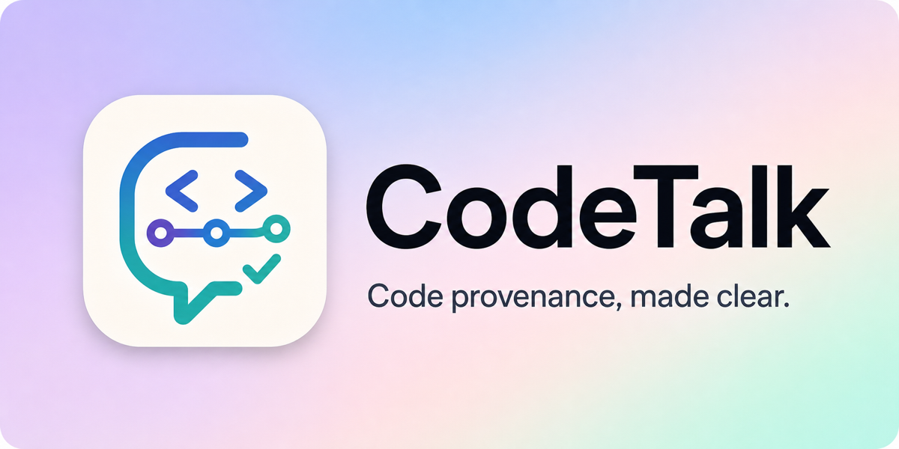
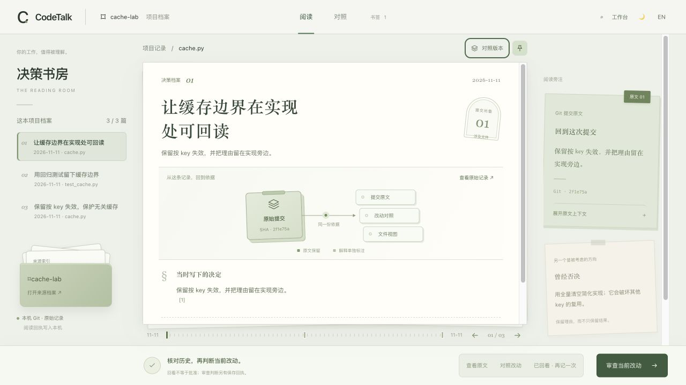
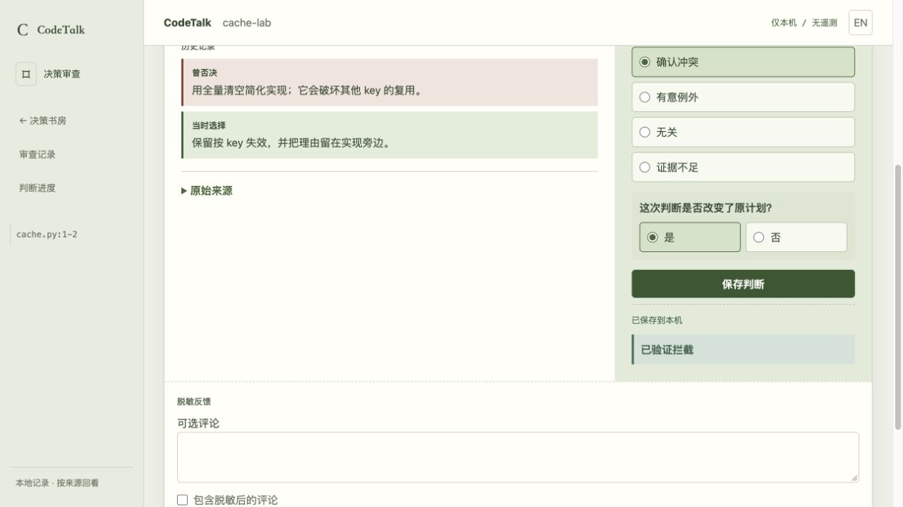

<p align="center"><a href="README.md"><b>English</b></a> · <a href="README.zh-CN.md">简体中文</a></p>

<!-- mcp-name: io.github.hukair/codetalk -->

<p align="center"></p>

**AI writes the change. CodeTalk brings back the decision that change may be repeating.**

CodeTalk connects a local diff to recorded decisions, rejected alternatives and
session evidence. The core is zero-LLM, local-first, and pure standard library.
Generated interpretation stays separate from original sources; the maintainer
makes the judgment.

> 0.4.0 development source · package publication not yet enabled.
> Install this checkout to try these features; the published PyPI version may differ.

## See it work

The **Decision reading room** puts commit chapters, original decision notes and
rejected alternatives side by side. Open the actual diff, keep a local bookmark,
or review the current uncommitted change.





These are **synthetic inputs through the real backend**, not customer outcomes or
an accuracy benchmark. “Verified interception” means a human recorded both a
confirmed conflict and a changed action; CodeTalk does not block or edit code.

```bash
python -m scripts.demo_reading_room
```

Run from the source checkout and open the printed loopback URL. The demo uses an
isolated Git repository and cache, needs no API key, and retains its temporary
files. [Demo walkthrough](docs/demo.md) · [Static illustrative demo](index.html)
(the static page simulates judgments and does not save to the backend).

## Install

Python 3.11+ and Git are required. With a downloaded source archive, open its
directory and begin at the virtual-environment step.

```bash
git clone https://github.com/HUKAIR/CodeTalk.git
cd CodeTalk
python3 -m venv .venv
source .venv/bin/activate
python -m pip install -e .
python -m codetalk demo
```

Windows PowerShell: activate with `.venv\Scripts\Activate.ps1`.
The distribution name is `hukair-codetalk`; the installed command is `codetalk`.

## Use your own repository

```bash
codetalk doctor --project .                 # inspect local evidence coverage
codetalk console --serve --project .        # reading room + search + local writes
codetalk review --serve --project .         # review the current uncommitted diff
codetalk blame path/to/file.py:20-40         # inspect line-level recorded decisions
codetalk search cache                       # search original notes and cached context
```

A fresh clone may have no uncommitted diff or recorded decision notes. CodeTalk
shows that gap; it does not invent a rationale. The reading room still displays
original commits without enrichment.

| Surface | What is available |
|---|---|
| Console | Overview, reading timeline, decision graph, comprehension debt, file tree, prompt replay, session recap |
| Reading | Original commit text, chosen/rejected/watch notes, bounded Git diff comparison, local bookmarks |
| Review | Confirmed conflict, intentional exception, unrelated, insufficient evidence; local judgment and optional feedback export |
| Optional web | Grounded chat and citations, console, timeline, graph, course and review; selected project follows requests |
| Coding clients | Seven read-only MCP tools; VS Code / Cursor / Windsurf extension |

`codetalk console` without `--serve` exports a self-contained, read-only page.
Search across the repository, diff loading and writes require the local service.
Bookmarks are browser-local reading state. Reading a record is not review approval.
[Complete UI / endpoint map](docs/ui-functions.md).

Optional chat requires the web extra:

```bash
python -m pip install -e ".[web]"
codetalk web --project . --no-llm
```

This binds `127.0.0.1` and returns deterministic grounded listings with model calls
disabled. Optional synthesis follows provider configuration; it is not required
for the reading room, search or review.

## Keep the reasons

Record real choices in commit messages:

```text
Vibe-Decision: Invalidate one key; preserve unrelated cached results.
Vibe-Rejected: Clear the whole cache; it repeats unrelated work.
Vibe-Watch: Verify empty-cache and missing-key behavior.
```

`codetalk install-agent-seed` appends this convention to `CLAUDE.md`, `AGENTS.md`,
`.cursorrules`, `.cursor/rules/codetalk.mdc` and `.github/copilot-instructions.md`.
Existing content is preserved. [Decision-note reference](docs/reference.md#decision-notes-make-ask--graph-sharper).

## Privacy and limits

Local records and SQLite cache stay on this machine by default. The UI loads no
CDN or telemetry. Optional remote model calls are the exception; secret redaction
is not anonymization, and ordinary code or conversation text can remain visible
to the configured provider.

```bash
codetalk enrich --project .                    # local evidence + no-request plan
codetalk enrich --project . --payload-preview  # inspect one redacted payload
codetalk enrich --project . --allow-remote     # authorize this remote run
```

Records may be incomplete or wrong. File/history association is not proof of
semantic conflict or causation. Session formats can change; unavailable sources
degrade to Git-only evidence. There is no claimed real-world interception rate.

[Commands & configuration](docs/reference.md) · [MCP setup](docs/mcp-install.md) ·
[Contributing](CONTRIBUTING.md) · [Development & merge policy](docs/development.md) ·
[Security](SECURITY.md) · [Changelog](CHANGELOG.md)
