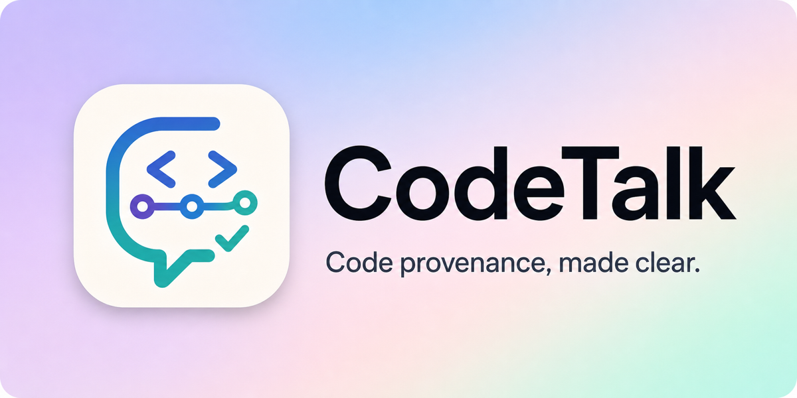
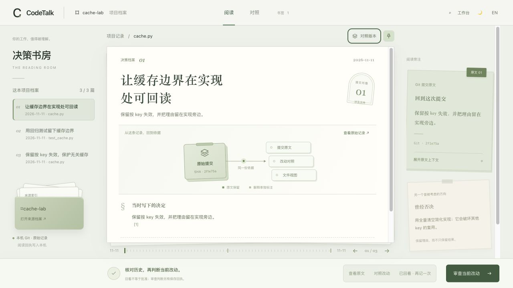
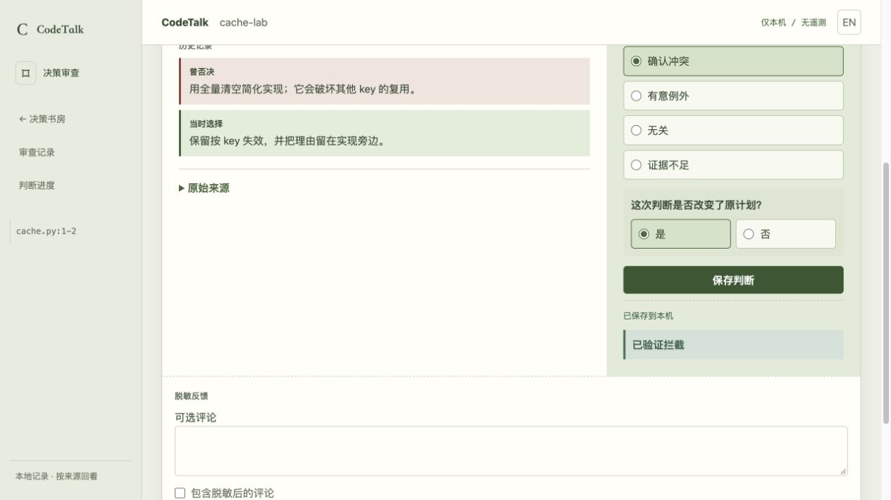

<p align="center"><a href="README.md">English</a> · <a href="README.zh-CN.md"><b>简体中文</b></a></p>

<p align="center"></p>

**AI 写下改动，CodeTalk 找回这次改动可能正在重复的旧决定。**

CodeTalk 将本地 diff 与真实提交、曾否决的方案和会话记录对照。内核零 LLM、
本地优先、纯标准库；生成解释与原始证据分开显示，最终判断由维护者完成。

> 0.4.0 开发源码 · 软件包发布尚未启用。
> 请从当前源码安装；PyPI 已发布版本不保证包含这里的功能。

## 看看它如何工作

**决策书房**将提交章节、原始决定和否决理由放在一起。你可以打开真实 diff，
留下本机书签，或进入当前未提交改动的审查。





截图是**合成数据走真实后端**，不是客户成果或准确率评测。“已验证拦截”表示
人同时记录了“确认冲突”和“改变行动”；CodeTalk 不会自动阻止或修改代码。

```bash
python -m scripts.demo_reading_room
```

在源码目录运行后，打开终端打印的本机地址。演示使用隔离 Git 仓库和缓存，
无需 API key，临时文件会保留。[演示步骤](docs/demo.md) · [静态体验](index.html)
（静态页只模拟判断，不写入后端）。

## 安装

需要 Python 3.11+ 和 Git。若已下载源码压缩包，解压进入目录后从创建虚拟环境开始即可。

```bash
git clone https://github.com/HUKAIR/CodeTalk.git
cd CodeTalk
python3 -m venv .venv
source .venv/bin/activate
python -m pip install -e .
python -m codetalk demo
```

Windows PowerShell 用 `.venv\Scripts\Activate.ps1` 激活环境。
发行包名为 `hukair-codetalk`，安装后的命令仍为 `codetalk`。

## 用在自己的仓库

```bash
codetalk doctor --project .                 # 查看本机证据覆盖与缺口
codetalk console --serve --project .        # 书房、检索和本地写回
codetalk review --serve --project .         # 审查当前未提交 diff
codetalk blame path/to/file.py:20-40         # 回读行级历史决定
codetalk search cache                       # 搜索原始记录与缓存上下文
```

新克隆可能没有未提交改动，也没有决策记录。CodeTalk 会显示缺口，不补编理由。
即使没有做过富集，书房仍能展示原始提交。

| 入口 | 已有能力 |
|---|---|
| 控制台 | 开工概览、阅读时间轴、决策图、理解债、文件树、指令回看、会话摘要 |
| 阅读 | 提交原文、选择／否决／待验证、限长 Git diff 对照、本机书签 |
| 审查 | 确认冲突、有意例外、无关、证据不足；本地保存判断、可选反馈导出 |
| 可选 Web | 接地对话与引用、控制台、时间轴、图谱、课程、审查；请求保留所选项目 |
| 编程客户端 | 七个只读 MCP 工具；VS Code / Cursor / Windsurf 扩展 |

`codetalk console` 不加 `--serve` 时导出自包含只读页面；全仓检索、加载 diff 和
写回需要本地服务。书签仅保存浏览器阅读状态，回看不等于审查批准。
[完整功能与接口对应表](docs/ui-functions.md)。

可选接地对话需要安装 Web 扩展依赖：

```bash
python -m pip install -e ".[web]"
codetalk web --project . --no-llm
```

服务绑定 `127.0.0.1`，此命令关闭模型调用并返回确定性的证据列表。
可选生成遵循模型配置；书房、搜索和审查无需模型。

## 把理由留下来

在 commit message 中记录真实发生的选择：

```text
Vibe-Decision: 只失效发生变化的 key，保留其他缓存结果。
Vibe-Rejected: 清空整个缓存；它会重复无关计算。
Vibe-Watch: 验证空缓存和缺失 key 的行为。
```

`codetalk install-agent-seed` 会向 `CLAUDE.md`、`AGENTS.md`、`.cursorrules`、
`.cursor/rules/codetalk.mdc` 和 `.github/copilot-instructions.md` 追加约定，保留已有内容。
[详细用法](docs/reference.zh-CN.md)。

## 隐私与边界

本地记录和 SQLite 缓存默认留在本机，界面不加载 CDN、不发送遥测。
可选远程模型调用是例外；密钥脱敏不等于匿名化，普通代码、业务逻辑和会话原文
仍可能对配置的服务商可见。

```bash
codetalk enrich --project .                    # 本地证据与零请求计划
codetalk enrich --project . --payload-preview  # 检查一份脱敏载荷
codetalk enrich --project . --allow-remote     # 明确授权本次远程调用
```

记录可能不完整或有误；文件历史关联不是语义冲突或因果关系的证明。
会话格式变更或来源缺失时降级为 Git 证据。不宣称真实项目拦截率。

[命令与配置](docs/reference.zh-CN.md) · [MCP 安装](docs/mcp-install.md) ·
[贡献](CONTRIBUTING.md) · [开发与合并](docs/development.md) ·
[安全](SECURITY.md) · [更新记录](CHANGELOG.md)
