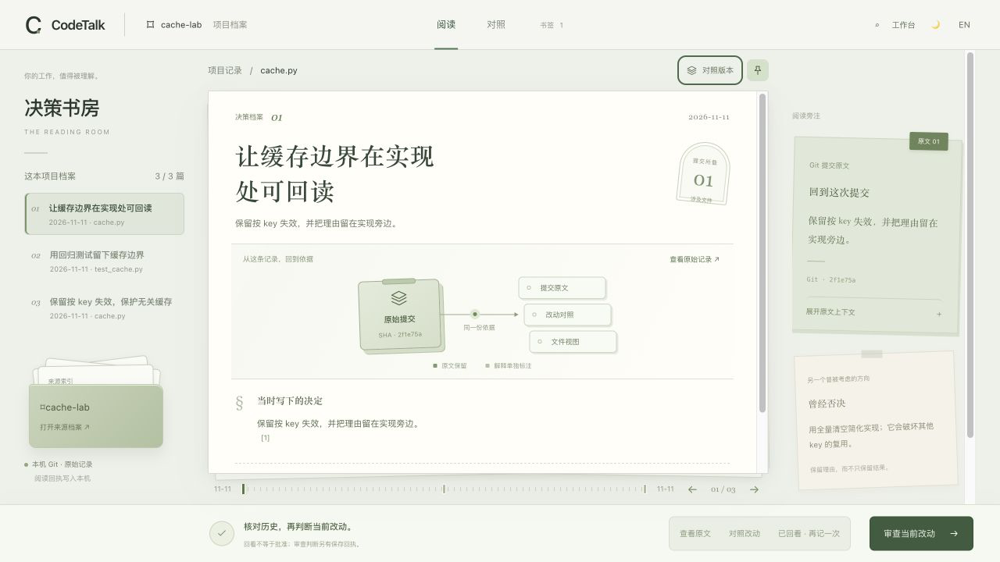
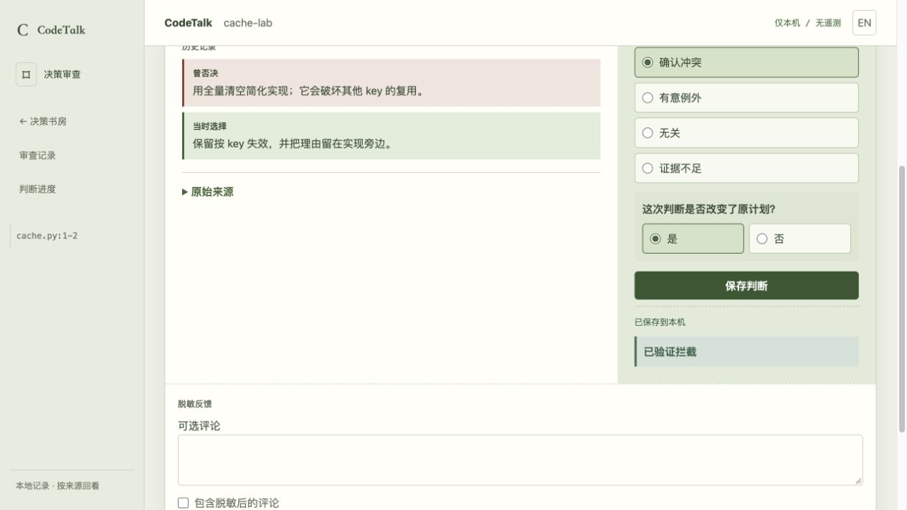

# Try the decision reading room / 体验决策书房

Run from the source checkout with Python 3.11+ and Git:

```bash
python -m scripts.demo_reading_room
```

Open the printed `http://127.0.0.1:…/#timeline` URL in a desktop browser.
This uses **synthetic Git commits, a synthetic session, and a real local backend**.
No key, web extra or model request is needed. Its cache, session files and usage
log are isolated from your normal CodeTalk data. Ctrl+C stops the server;
the temporary directory is retained.

## Read, compare, review

1. Select a chapter. Read the original chosen/rejected/watch notes, then expand
   the full commit message in the source note (the folder opens it too). Cached interpretation is separately labeled.
2. Open **Compare changed lines**. Both sides come from the actual Git diff;
   drag the divider to compare them. This is bounded diff context, not a reconstruction of whole files.
3. Add a bookmark and reload. It remains in this browser. **Mark as read** writes
   a local reading signal, not approval of the code change.
4. Type `失效` and press Enter for full-repository search. Results distinguish
   original records, cached interpretation and conversations.
5. Open **Review current changes**. The uncommitted diff uses `cache.clear()`;
   inspect the historical rejection before choosing a judgment.
6. Save each of the four outcomes and reload to verify persistence. A **Confirmed
   conflict** also requires the action-changed choice. Only confirmed conflict
   plus changed action counts as a recorded interception. This is a human input,
   not an automatic semantic verdict or an actual code block.
7. Preview/export optional sanitized feedback locally. No report is sent remotely.





These screenshots come from the script above. They demonstrate working UI and
persistence, not customer outcomes or semantic accuracy. The core review snapshot
is taken when the server starts; restart if you edit its working-tree diff.

The original B composition is retained: top reading modes, chapter index and
folder, layered paper, source stamp and margin notes, timeline ruler and bottom
actions. The seven existing views are available from **Workspace**; search is
available from the header or `/`. The bottom actions save a real reading receipt
or open current-change review; they do not reuse the prototype’s simulated judgments.

## Other ways to try it

| Entry | Purpose |
|---|---|
| `python -m scripts.demo_review` | One synthetic review card, actual save and feedback endpoints |
| `python -m scripts.demo_ui` | Real-template gallery; synthetic states, no backend saves |
| [index.html](../index.html) | No-server illustrative walkthrough; simulated judgments |
| `codetalk console --serve --project .` | Real records and local writes for your repository |
| `codetalk review --serve --project .` | Review your current uncommitted diff |

To export the gallery without a server:

```bash
python -m scripts.demo_ui --output /tmp/codetalk-ui-gallery --no-serve
```

## 中文说明

这套演示用虚构 Git 历史和会话驱动真实书房、搜索、diff、判断和反馈接口。
先回读原始理由，再作人工判断；“已回看”“已保存判断”“已验证拦截”含义不同。
书签留在浏览器，胶囊与判断写入隔离缓存。刷新后可验证持久化。

演示无需密钥，不访问个人会话和正常缓存，不调用模型，不向外提交反馈。
静态体验和模板画廊仍只模拟状态；要检查真实写回，请运行本页开头的命令。
