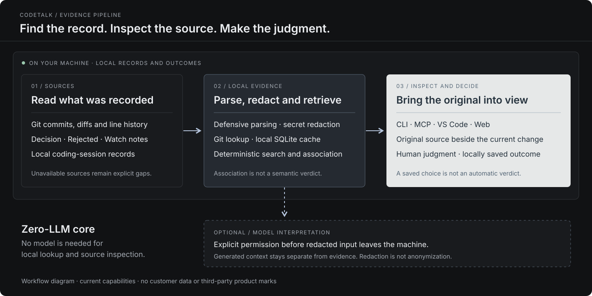

# CodeTalk reference

[English overview](../README.md) · [中文概览](../README.zh-CN.md) · [UI coverage](ui-functions.md)

## 用到你自己的仓 / On your own repo

```bash
codetalk demo                            # 30 秒看效果,零配置
codetalk doctor --project /path/to/your/repo
codetalk search "cache" --project /path/to/your/repo
codetalk blame path/to/file.py --project /path/to/your/repo
```

将项目路径、关键词和受 Git 跟踪的文件换成你的实际内容。`search` 查找已记录的理由
并列出提交 ID；`blame` 列出该文件已有的决定历史。用下面的命令核对原始提交说明：
`git -C /path/to/your/repo show --no-patch --format=fuller COMMIT_SHA`。
这些命令不需要模型密钥或富集；无匹配记录表示缺少依据，不能据此编造理由。
本地检索可能创建或更新 CodeTalk 缓存。

需要在浏览器审查未提交改动时，运行
`codetalk review --serve --project /path/to/your/repo`。
如需让后续 Agent 提交记录理由，可选运行
`codetalk install-agent-seed --project /path/to/your/repo`；它会写入项目中的
Agent 指令文件，请检查变更后再提交。

`review` 读的是本地未提交 diff;fresh clone 还没有可审内容——先跑 `codetalk demo`
或改点东西再审。

**诚实冷启动:** 没有决策记录、也没有富集的仓库只有 commit subject，接近
`git log`。决策记录负责捕捉未来的 why；可检查的富集可以给旧 commit 补生成解释。
CodeTalk 找回的是被记录的内容，不保证代码或源记录本身正确。

## 构建并安装 MCP bundle(.mcpb)

把零-LLM 接地能力暴露给 Claude Code / Cursor / Codex 等 MCP 客户端,在 agent 工作流里
直接问「这段代码当初为什么这么写」。CodeTalk 核心纯标准库,可打成一个 `.mcpb`
(zip:`manifest.json` + 源码);构建一次后可直接拖入支持的客户端,靠你已装的
`python3` 运行、**不打包解释器**:

```bash
python3 -m scripts.build_mcpb     # 产出 dist/codetalk-0.4.0.mcpb
```

构建出的 `codetalk-0.4.0.mcpb` 可以直接拖进客户端安装;在 GitHub 提供可下载 Release 前,
源码 checkout 需要先构建一次。安装时选一个项目根目录即可,暴露 **7 个工具**
(全标 `readOnlyHint: true`,Claude Code / Cursor 可自动批准不弹确认):

| 工具 | 作用 | LLM |
|---|---|---|
| `codetalk_ask` | 接地提问「当初为什么这么写」 | 有 key 用 LLM;无 key 降级确定性 |
| `codetalk_blame` | 行级决策溯源 | 零 LLM |
| `codetalk_graph` | 决策影响图(时间轴 DAG) | 零 LLM |
| `codetalk_search` | 主题级「为什么」召回 | 零 LLM |
| `codetalk_drift` | 偏差自检:AI 工具写过但未见后续同路径提交的文件 | 零 LLM |
| `codetalk_prompts` | 指令回看:你给 AI 下了什么指令 | 零 LLM |
| `codetalk_adr` | ADR 导出:MADR / Nygard / CycloneDX(AIBOM) | 零 LLM |

> 各客户端逐步安装 + 自检 + 排错见 **[`docs/mcp-install.md`](mcp-install.md)**。
> Spec-driven 工作流(GitHub Spec Kit / AWS Kiro / OpenSpec / Antigravity)对接见
> **[`docs/spec-kit-integration.md`](spec-kit-integration.md)**。

## IDE Extension (VS Code / Cursor / Windsurf)

**IDE 扩展**——可折叠 CodeLens + hover 决策卡：点开一条提交看 why / decision / rejected / risk，hover 任意行看完整上下文。类 GitLens 但补 why。

```bash
cd vscode-codetalk
npm install && npm run build                        # 构建
npm run package                                      # 打包 .vsix
```

安装（三选一）：

```bash
cursor --install-extension vscode-codetalk-0.4.0.vsix   # Cursor
code --install-extension vscode-codetalk-0.4.0.vsix      # VS Code
# Windsurf: Extensions → Install from VSIX → 选文件
```

装完 Cmd+Shift+P → **Reload Window**，打开有 CodeTalk 缓存的项目即可看到可展开的决策 CodeLens；hover 行可看完整卡片。

| 设置 | 默认 | 说明 |
|---|---|---|
| `codetalk.enabled` | `true` | 主开关 |
| `codetalk.pythonPath` | `"python3"` | 装了 CodeTalk 的 Python 解释器路径 |

> 详细安装 + 排错 + 配置见 **[`vscode-codetalk/README.md`](../vscode-codetalk/README.md)**。

## codetalk web —— 自托管接地对话(新)

一个本地优先的交互网页:和 LLM 多轮讨论「这段代码当初为什么这么写」,但每一轮**先零-LLM
检索你项目的真实记录**(commit 叙事 / 决策记录行 / 会话原话),把真实证据喂给模型,答案旁
**并排可核验的引用**;讨论本身脱敏后落库,反哺未来的 `ask`/`search`。**自托管 = 数据留在
你自己机器,卖软件不卖服务。**

```bash
pip install -e ".[web]"                            # web 面可选 extra(FastAPI/uvicorn;CLI/MCP 仍纯 stdlib)
codetalk web --project /path/to/repo              # 绑 127.0.0.1、自动开浏览器、逐字流式
codetalk web --project /path/to/repo --no-llm     # 零出网:降级为零-LLM 接地罗列
```

- **接地、可核验**:答案锚定真实 commit / 决策 / 会话原话,每条结论旁的引用可点开核验——这是
  和「套壳聊天」的分界线;**模型脱离真实材料不作答**(材料空 → 不调模型,只确定性罗列)。
- **隐私红线**:默认只绑 `127.0.0.1`、绝不 phone home(除 LLM 调用)、出网前 + 落库前脱敏、
  前端零外联(CSP `connect-src 'self'`;静态产物经 `scripts/check_static_no_external.py` 守);
  后端拒绝非 loopback Host 与跨 Origin 请求,防其它网页借 localhost 触发本地检索/LLM 调用。
- **自托管**:单镜像 Docker(见 `Dockerfile`:`docker build -t codetalk .` → `docker run`)。
- 前端首版为零-build 单文件 vanilla-JS;React/Vite 仅在 chat UX(流式已有,后续如需消息管理)再上。

## 配置

```bash
codetalk init        # 写配置模板到 ~/.codetalk/config.json(自动 chmod 600)
```

`~/.codetalk/config.json`:

```json
{
  "vault_path": "/path/to/obsidian/vault/folder",
  "provider": "deepseek",
  "model": "deepseek-v4-pro",
  "diff_token_budget": 3000,
  "output_lang": "中文",
  "providers": {
    "deepseek":  {"base_url": "https://api.deepseek.com/v1", "api_key": "sk-..."},
    "openai":    {"base_url": "https://api.openai.com/v1", "api_key": ""},
    "qwen":      {"base_url": "https://dashscope.aliyuncs.com/compatible-mode/v1", "api_key": ""},
    "kimi":      {"base_url": "https://api.moonshot.cn/v1", "api_key": ""},
    "doubao":    {"base_url": "https://ark.cn-beijing.volces.com/api/v3", "api_key": ""},
    "glm":       {"base_url": "https://open.bigmodel.cn/api/paas/v4", "api_key": ""},
    "grok":      {"base_url": "https://api.x.ai/v1", "api_key": ""},
    "gemini":    {"base_url": "https://generativelanguage.googleapis.com/v1beta/openai", "api_key": ""},
    "anthropic": {"api_key": ""},
    "ollama":    {"base_url": "http://localhost:11434/v1", "api_key": "ollama"}
  }
}
```

切换模型:把顶层 `provider` 改成上面任一,并设对应 `model`(如 kimi→`kimi-k2-0905-preview`、
glm→`glm-4.6`、grok→`grok-4`、gemini→`gemini-2.5-pro`、doubao→端点 ID 或 `doubao-seed-1-6`)。
API key 也可用环境变量 `<PROVIDER>_API_KEY`(如 `DEEPSEEK_API_KEY` / `KIMI_API_KEY` /
`GLM_API_KEY` / `GROK_API_KEY` / `GEMINI_API_KEY` / `DOUBAO_API_KEY` / `ANTHROPIC_API_KEY`)。
除 anthropic 走官方 SDK(json_schema 结构化输出 + prompt caching)外,其余全走 OpenAI 兼容
协议(标准库 urllib,零额外依赖;DeepSeek 上下文缓存自动生效)。

**零-egress 本地推理**:把 `provider` 设为 `ollama`,或配置 hostname 精确等于 `localhost`、
`127.0.0.1`、`::1` 的 OpenAI 兼容端点(如 LM Studio / llama.cpp / vLLM)。CodeTalk 不信任
`local` 标签,也不会把仅仅包含 `localhost` 的远端域名当成本机。此时综合推理在本机运行;
与 `--no-llm`(完全不调 LLM)形成两档隐私梯度。

**可检查的远端富集**:普通 `codetalk enrich` 即使配置了 API key 也不会调用远端模型。
计划会列出 provider、准确目标 origin、model、未缓存范围、输入类别及上限、脱敏计数和
缓存影响。服务商保留策略不在 CodeTalk 的保证范围内。只有检查后显式加
`--allow-remote` 才授权该次远端运行；准确解析出的 loopback 端点仍视为本机。

## 命令

| 命令 | 做什么 | 例 |
|---|---|---|
| `demo` | **30 秒看效果**:现造一个一次性小仓、跑真实 `blame`——零 key、零配置、零 enrich | `codetalk demo` |
| `doctor` | **首跑诊断**:证据覆盖、会话源、LLM 配置状态和下一步建议(**纯本地零 LLM**) | `codetalk doctor --project .` |
| `review` | 把当前 diff 变成聚焦的决策审查卡；支持终端、JSON 和本地浏览器(**零 LLM**) | `codetalk review --serve --project .` |
| `blame` | **行级决策溯源**:确定性罗列一段行背后的 commit、决策记录与会话锚点(**零 LLM**,无 key 也能用) | `codetalk blame codetalk/llm.py:72-78` |
| `search` | **主题级「为什么」召回**:全仓按关键词找——逐字决策记录 + 缓存叙事,分源标注(**零 LLM**) | `codetalk search urllib` |
| `digest` | 把一段时间的 commit + 会话富集成**变更叙事日报**(防幻觉、信件体、内嵌时间胶囊) | `codetalk digest --since "3 days ago"` |
| `enrich` | 本地补证据并展示零请求计划；远端生成需逐次明确授权 | `codetalk enrich --project . --payload-preview` |
| `brief` | **开工简报**:你上次停在哪 + 理解债 top 3(**纯本地零 LLM**);`--all` 出**跨项目总览**(所有项目里有到期胶囊的 + 理解债最高的几个,按紧迫度) | `codetalk brief` · `codetalk brief --all` |
| `watch` | **待验证收件箱**:跨项目列出到期仍未回填的预测(**零 LLM**) | `codetalk watch` |
| `self` | **自我周报**:近 N 天用量/省额/回填率,自证关掉 LLM 仍有价值(**零 LLM**) | `codetalk self --days 7` |
| `prompts` | **指令回看**:按会话时间线列出你发给 AI 的指令 + 改过的文件(**零 LLM**) | `codetalk prompts --since "3 days ago"` |
| `drift` | **偏差自检**:AI 工具写过但未见后续同路径提交的文件(**零 LLM**) | `codetalk drift` |
| `graph` | **决策影响图**:哪个决定牵动了后续哪些改动(时间轴 DAG,**零 LLM**;`--canvas` 导出 Obsidian Canvas) | `codetalk graph --canvas` |
| `course` | **演进课程**:项目怎么一步步长成这样(分章 + 大白话 + 场景测验,单文件 HTML) | `codetalk course` |
| `ask` | **就某段代码提问**,答案接项目记忆(叙事 + 决策记录行),引用真实 commit | `codetalk ask codetalk/llm.py:72-78 "为什么这么写"` |
| `console` | **统一控制台(web 入口)**:开工概览 / 时光轴 / 决策图 / 理解债 / 文件树 / 指令回看 / 会话摘要七视图单页(**零 LLM**;`--serve` 回写胶囊) | `codetalk console --serve` |
| `recap` | **会话摘要**:会话索引页(全部会话按日期分组、带提问预览)+ 每会话结论先行详情页——轮卡片带时刻与类型徽章、筛选 chips、迷你日程图(**零 LLM**) | `codetalk recap` |
| `tunnel` | **时光轴**:线性提交时间线,最新在顶、按天分组、点开看叙事(`--serve` 胶囊回答即时写回) | `codetalk tunnel` |
| `report` | **实时汇报**:从当前仓状态生成单页 web——变更/决策记录/发现(**零 LLM**) | `codetalk report --serve` |
| `adr-export` | **ADR 导出**:把一段代码的真实决策史导出成 MADR / Nygard / CycloneDX(AIBOM),逐字引真实 commit(**零 LLM**) | `codetalk adr-export codetalk/llm.py` |
| `mcp-serve` | **MCP server(stdio)**:向 MCP 客户端暴露 7 个只读 `codetalk_*` 接地工具 | `codetalk mcp-serve --project .` |
| `install-hook` | 装 git 钩子:手写 commit 时提示填写三类 `Vibe-*` 决策记录 | `codetalk install-hook` |
| `install-agent-seed` | 幂等追加到 `CLAUDE.md`、`AGENTS.md`、`.cursorrules`、`.cursor/rules/codetalk.mdc`、`.github/copilot-instructions.md`;保留既有内容 | `codetalk install-agent-seed` |

`digest` 产物:`<vault>/YYYY-MM-DD-<project>.md` —— 去年今日 / 上月今日回流 → 今日概览(信件体)
+ 今日决定 → 到期的时间胶囊(供回填)→ 按 commit 的叙事 → 未闭环汇总 → 运行统计。时间胶囊把
每条 risk 密封 21 天,到期在日报里端回面前,闭合「预测—验证」环。

### 决策记录行(让 `ask` / `graph` 更准)

做关键技术取舍时,在 commit message 正文留一行:

```
Vibe-Decision: 用 urllib 不引第三方——M0 禁三方依赖
Vibe-Rejected: 再引一个 HTTP 库——会破坏核心零依赖
Vibe-Watch:    先这么扛,并发安全待验证
```

`Vibe-Decision` 记录所选方案,`Vibe-Rejected` 保留认真考虑但放弃的方案及原因,
`Vibe-Watch` 记录以后要验证的风险。`ask`、`blame`、`review` 会连同 commit SHA 展示这些原话;
`graph` 用已选决策连接影响边。行首精确匹配、区分大小写。

手写 commit(不带 `-m`)的提交者,跑一次 `codetalk install-hook` 装 `prepare-commit-msg` 钩子,
编辑器里会自动提示三类记录——填了就保留在 commit message 里,不填会被 git 剥除。git 钩子不随仓库版本控制,
**每个 clone 各装一次**。

## 缓存与隐私

- commit 叙事以 SHA 为键缓存于 `~/.codetalk/cache.db`,**永不重算**;重跑同一天 digest 为
  0 次 LLM 调用、亚秒级返回。`graph:`/`course:`/`ask:` 派生结果同表加前缀键缓存。
- 会话解析以 (session_id, mtime, size) 增量缓存;每次运行参数追加到 `~/.codetalk/usage.log`。
- **远端 `enrich` 默认不发送。** 该命令必须显式带 `--allow-remote`;API key 是配置,不是
  同意。允许的模型请求及写缓存 / vault / HTML 之前,常见 secret 模式(API key / token /
  JWT / 私钥 / Google / Stripe / Slack 等)一律脱敏。脱敏不等于匿名化;计划会明确列出仍
  可能可见的数据与服务商保留边界。其他可选模型命令遵循各自文档和配置。
- **`no_llm` 硬开关**:把那个「LLM 调用」例外也关掉,**保证零 egress**。三种方式任一即生效,
  全局覆盖(含 MCP `ask` 工具):config.json 置 `"no_llm": true`、设环境变量 `CODETALK_NO_LLM=1`、
  或给 `digest`/`enrich`/`ask`/`course`/`web` 加 `--no-llm`。开启后
  blame/graph/search/brief/prompts 照常,enrich 仍完成本地证据和计划,
  ask/course/MCP ask 降级为确定性检索,digest 因必须用 LLM 而直接退出(信息明确,不静默)。

## 已知限制(M0)

- 会话源不是完整审计日志:Claude 主会话与 `*/subagents/**/agent-*.jsonl` 会纳入,但
  journal/meta 等旁路文件不采;Cursor / Codex 本地会话源为 opt-in 且依赖非官方本地格式。
- 会话-commit 对齐是软关联(±30 分钟时间窗 + 文件交集),目标准确率 80%,带 high/low 置信度
  标注,**不保证全对**。
- commit 被 amend / rebase 后 SHA 变化即视为新 commit;旧 SHA 缓存成为死数据。
- `graph` 文件级边在极小项目偏密,靠稀疏节点压制;行级精度作非目标延后。
- Claude Code / Cursor / Codex 的本地会话格式都非官方稳定 API;版本升级可能破坏解析,
  解析器对未知字段忽略、缺字段降级,最坏退化为纯 git 模式。

## Pipeline / 管道

CodeTalk 读取 git 历史与本地 AI 编码会话，容错解析并按时间与文件交集建立软关联，
把脱敏证据存进本地 SQLite，再提供确定性审查与检索工具。可选模型综合位于证据层之后。



### 这些词在 CodeTalk 里具体指什么

- **决策记录行**(内部曾叫 breadcrumbs / 面包屑):commit message 中三类可选行。
  `Vibe-Decision` 记录所选方案及原因，`Vibe-Rejected` 记录认真考虑但放弃的方案及原因，
  `Vibe-Watch` 记录以后要验证的风险。
- **接地证据**:CodeTalk 能直接引用的 commit message、决策记录、测试、Pull Request 与
  本地会话原话。没有证据时只报告缺口，不让模型自行补答案。
- **生成解释**:可选模型写出的可读上下文，始终独立显示，绝不升级为决策证据。
- **零-LLM / 零出网**:只做本地确定性查找；`--no-llm` 关闭支持该参数的全部可选模型调用。
- **时间胶囊**:让 `Vibe-Watch` 风险在未来重新出现，供维护者记录实际结果。
- **MCP**:把 CodeTalk 工具接入 Claude Code、Cursor、Codex 等编码客户端的协议。
- **理解债**:优先列出最近频繁变动、带未闭环风险或尚未认真回看的文件和决策。

> **能力边界：** CodeTalk 找回已有记录；记录仍可能不完整或有误，是否适用于
> 当前改动需要人工判断。合成演示验证操作流程，不证明召回准确率或真实拦截率。
> 新仓的全新历史无法复现旧五提交研究，本 README 不以该研究宣称性能。
> CLI 输出目前以中文为主。

## 架构

```
cli → gitlog(commit/diff/行历史/决策记录行) ─┐
      sessions(Claude/Cursor/Codex 容错) ─┼→ align(软关联) → enrich(LLM,SHA 缓存) → report → vault
      cache(SQLite 单一真相源)          ─┘
零-LLM 工具:brief / debt / graph 直接读 cache + git,不经 enrich/llm。
LLM 统一封装:llm.py(多 provider / 重试 / token 日志 / prompt caching / 反幻觉+文风纪律)。
```

## 设计哲学(M0)

核心 CLI/MCP 面保持标准库 + anthropic SDK(可选);**禁** LangGraph / 向量库 / 重前端链路。
`codetalk web` 是可选 web extra,仅该面允许 FastAPI / uvicorn,且惰性 import、不污染核心依赖。
单模块 <300 行;解析外部数据一律容错、失败降级绝不崩溃。行为准则见 `CLAUDE.md`(Karpathy
编码纪律:想清再写 / 简单优先 / 外科手术式改动 / 目标驱动)。

## 发布与贡献

- 发布前检查: [`RELEASE_CHECKLIST.md`](../RELEASE_CHECKLIST.md)
- 变更记录: [`CHANGELOG.md`](../CHANGELOG.md)
- 贡献约束: [`CONTRIBUTING.md`](../CONTRIBUTING.md)
- 安全报告: [`SECURITY.md`](../SECURITY.md)
